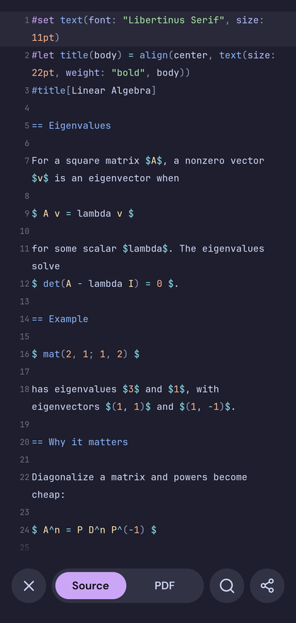
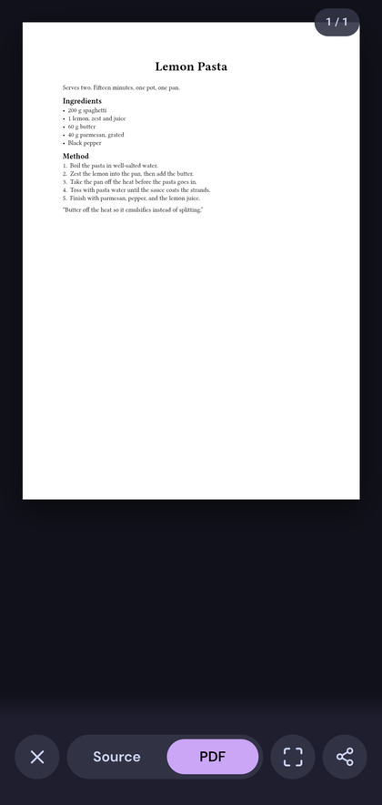
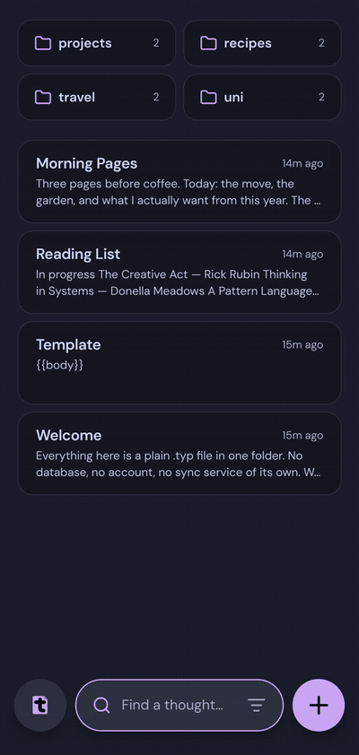
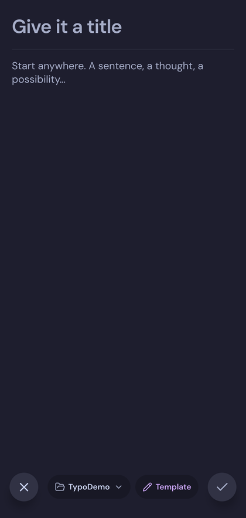
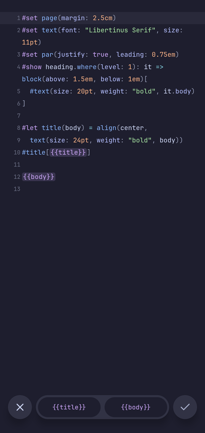

# Typo

Typo is an Android app for [Typst](https://typst.app) notes in a plain folder.
Open the folder, search your notes, write, and take the compiled PDF with you.
Your `.typ` files are the source of truth. There is no account, server, or
app-specific sync layer.

  
  
  

## Install

Typo ships as an APK on
[GitHub releases](https://github.com/DontBlameMeDev/typo/releases). It needs
Android 7.0 or newer and a 64-bit ARM phone.

### Obtainium (recommended)

[Obtainium](https://github.com/ImranR98/Obtainium) installs the APK and updates
it from the release page.

1. Install Obtainium from
   [F-Droid](https://f-droid.org/packages/dev.imranr.obtainium.fdroid/) or its
   [releases page](https://github.com/ImranR98/Obtainium/releases).
2. Tap **Add App** and paste `https://github.com/DontBlameMeDev/typo`.
3. Tap **Add**. Obtainium picks the APK from each release and offers new
   versions when they are published.

### Manual

Download `typo-<version>.apk` from the
[latest release](https://github.com/DontBlameMeDev/typo/releases/latest) and
open it. Android may ask you to allow installs from your browser or file
manager.

## Set up a vault

1. Keep the notes in one folder on the phone. To use them on more than one
   device, sync that folder with [Syncthing](https://syncthing.net) or another
   file sync tool.
2. Open Typo and pick the folder in Android's folder picker.
3. Typo remembers the folder and opens it on later launches.

If you sync the folder, pick the copy Syncthing writes, not an imported copy.
Typo opens internal storage and SD-card folders through Android's picker. Cloud
and third-party document providers are not supported.

## Use it

  

Search every note's name and text as you type. Tap a folder to browse, swipe a
note right to favorite it or left to move it to `.trash`, and long-press to
move it. The theme, accent color, and appearance live under the logo.

Source and PDF share one screen. Tap **Source** or **PDF** and the views slide
across. Type `#` to complete Typst commands, names defined with `#let`, and
imported names. Tap the ghost text or press Tab to accept. PDF text can be
selected, and URL links open in the browser.

Typo compiles with bundled fonts and fetches missing public packages from
`packages.typst.org`. Add the Quick Settings tiles to start a note from
anywhere or append to a chosen note section. Set the append target in Settings,
under Quick append.

## Template

  
  

New notes start from `template.typ` in the vault root. If the file does not
exist, Typo uses a default template and saving the template creates it. Open
the Template note, or tap **Template** on the New note screen, to change it. Use
`{{title}}` and `{{body}}` where the note title and text belong.

## Privacy

Notes stay on the device. Typo only connects to `packages.typst.org` to fetch
missing public packages. If you sync the vault, Syncthing or the file sync tool
you choose handles it.

## License

GPL-3.0. See [LICENSE](LICENSE).
